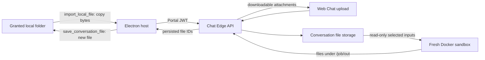

# Office documents and local folders

Workspace UX follow-up (2026-11-13): shared Web Chat/Electron file tabs, selection rewrites, recoverable drafts with Undo/Redo, review-before-accept AI proposals, checkpointed jobs, a cross-chat file library, geometry controls and a 12-template gallery are described in [Artifact workspace](ARTIFACT_WORKSPACE.md). Model/provider tests remain mocked.

Editor follow-up (2026-11-13): [visual editing, native PDF text replacement and AI Word/PPT/image correction](VISUAL_EDITOR.md), plus [version history/restore and video agents](OFFICE_EDITOR.md), are implemented in source. Earlier dated evidence below describes its own test pass.

Follow-up on 2026-11-13: [Office/media parity review](OFFICE_MEDIA_PARITY.md) covers reference-image edits, code-driven MP4 templates, current provider availability, live-editor gaps and the backend video confirmation boundary. The Office mechanics and prior test evidence below retain their original date.

Source review: **2026-11-12**, based on `e0313410` plus the working-tree changes described here.
This is a capability and implementation reference, not a deployment certificate.
“Office” means Word, Excel, PowerPoint and PDF work with local files and folders;
it does not mean disconnected/offline inference.

## Conclusion

Web Chat and Desktop can create downloadable Office files and process uploaded
documents. Desktop also has local filesystem, shell, browser and screen tools.
They are **not fully equivalent to Claude Desktop/Cowork**. This change closes
the local-file → conversation → Python → downloadable result → local-copy path
and fixes several document-editing defects. The follow-up adds 12 shared
templates and a converter-backed recalculation/render gate; see
[Office templates and delivery checks](OFFICE_TEMPLATES.md). It does not add a remote device
bridge, bundled local Office engine or universal fidelity guarantee.

## Reference behavior and research

The comparison uses public product documentation and publicly readable workflow
descriptions. No proprietary binary, private API or account data was inspected.
External pages were checked on 2026-11-12; availability can vary by plan and rollout.

| Reference | Behavior relevant to this project |
|---|---|
| [Claude file creation](https://support.claude.com/en/articles/12111783-create-and-edit-files-with-claude) | Code execution creates and edits XLSX, DOCX, PPTX and PDF; outputs are downloadable. Network access and package installation depend on policy. |
| [Cowork architecture](https://support.claude.com/en/articles/14479288-claude-cowork-architecture-overview) | Cloud sessions run the agent loop and code in a server sandbox. Local file operations are mediated by Desktop, connected folders and per-call permissions. An offline device cannot supply local files. |
| [Cowork across surfaces](https://support.claude.com/en/articles/15520349-use-claude-cowork-on-web-desktop-and-mobile) | Sessions and files follow the account across supported surfaces. New sessions on Pro/Max/Ultra moved to cloud execution on October 6, 2026; older desktop sessions are a separate case. |
| [Public XLSX workflow](https://github.com/anthropics/skills/blob/main/skills/xlsx/SKILL.md) | Formula recalculation and error checks are part of spreadsheet delivery; preserving a formula string alone does not prove its value. |
| [Public DOCX workflow](https://github.com/anthropics/skills/blob/main/skills/docx/SKILL.md) | Creating a document and editing an existing OOXML package require different handling. |
| [Public PPTX workflow](https://github.com/anthropics/skills/blob/main/skills/pptx/SKILL.md) | Template editing and visual inspection matter in addition to generating new slides. |
| [Public PDF workflow](https://github.com/anthropics/skills/blob/main/skills/pdf/SKILL.md) | Extraction, OCR, creation and page/form operations are distinct capabilities. |

Public workflow files are comparison material, not proof of every deployed
Claude behavior and not instructions installed into this project.

## Capability matrix after this change

“Implemented” below means present in source. The validation section separately
states what was executed. Model quality, deployment flags and installed tools
still determine whether a complete user task succeeds.

| Capability | Web Chat | Electron Desktop | Difference from the reference |
|---|---|---|---|
| Upload local documents | Browser file picker / drag-and-drop into conversation storage | Shared UI upload, plus `import_local_file` from a granted folder | Web cannot browse arbitrary local folders by itself |
| List/search local folders | No general host filesystem tool | Sidecar `list_directory` / `search_files`, under folder permissions | No web-to-desktop remote execution bridge |
| Read local Office files | Upload first | Sidecar `read_document`; import original bytes for sandbox editing | Text extraction is not a lossless document representation |
| Create XLSX/DOCX/PPTX/PDF | Plan cards and server `run_python` | Host `run_python` calls the same server sandbox | Requires reachable chat-edge, model and sandbox services |
| Edit attached/generated files | Source plan or `run_python(files=[id])` | `run_python` now forwards input IDs and returns reusable output IDs | One fresh sandbox per call; previous Python variables do not survive |
| Save result on local disk | Browser download | Browser download or `save_conversation_file` into a granted folder | New-file-only transfer; no automatic overwrite |
| Preserve Word styles | Existing template defaults retained unless explicitly changed | Same server generator; arbitrary Python path is model-authored | Tracked changes, comments and full Word layout fidelity not certified |
| Edit existing PowerPoint | Replace text, notes, move/delete slides, append slides | Same generator when a plan executes; `run_python` can use python-pptx | No comprehensive SmartArt/chart/image/theme editor |
| Spreadsheet calculations | Formula creation plus recalculation/error checks when Office converter is configured | Same shared quality stage | Disabled converter is explicitly reported; advanced workbook compatibility is not guaranteed |
| PDF | Text/OCR extraction and new ReportLab PDFs; page manipulation through Python | Local text reader with scanned-PDF relay; import for Python | A PDF plan creates a new PDF; it is not an exact-layout source editor |
| Document preview | Existing UI plus PDF/first-page PNG from Python outputs when converter is configured | Shared UI and image tool result | Every page is rendered/checked, but automatic rendering is not visual approval |
| Background work | Server chat streaming; Agent Market has its own job queue | Desktop turns/tasks depend on the host process | Ordinary desktop turns are not cloud Cowork sessions |

Agent Market remains a separate execution path with its own converter and queue.
Ordinary chat now has an optional `office-converter` deployment and
`OFFICE_CONVERTER_URL` setting. When configured, Python outputs and Office plans
use its quality stage. Merely running the Agent Market converter does not enable
that setting. See [deployment and limits](OFFICE_TEMPLATES.md#deployment).

## Where execution and data live



- Web agent loop: `internal/service/message_service.go` and `tools.go` in
  chat-edge. Desktop loop: `apps/desktop/src/main/turn-coordinator.ts`.
- Model requests travel through the gateway/backend. The sandbox itself has
  no network. Tool output sent to a model is a separate egress step governed
  by [DLP policy](DLP_ARCHITECTURE.md), including its exceptions and image limits.
- Uploading a local file copies it to server storage. “Local file access” does
  not mean its contents stay exclusively on the computer.
- Inputs are mounted read-only under `/job/in/<original_filename>`.
  Save outputs under `/job/out/`; other sandbox files are ephemeral.
- Desktop passes `conversation_id` to `/api/v1/code/run`. Inputs must belong
  to that conversation and caller. Outputs become durable conversation files.
- Calls without `conversation_id` retain the existing owner-scoped input and
  nonpersistent output contract; they are not the normal Desktop UI path.

## Desktop transfer contract

### Import

```json
{"name":"import_local_file","arguments":{"path":"C:\\Work\\budget.xlsx"}}
```

The folder must be granted in Desktop Settings. The host checks the absolute
path, resolved containment, regular-file status and size before upload. The
tool returns a `file_id` and display metadata with extraction initially pending; the coordinator links the file
to the assistant transcript. To edit the original binary, pass that ID to
`run_python.files`; do not reconstruct an existing workbook from extracted text.

Supported transfer extensions: `.xlsx`, `.docx`, `.pptx`, `.pdf`, `.csv`, `.tsv`,
`.txt`, `.md`, `.json`, `.png`, `.jpg`, `.jpeg`, `.webp`, `.gif`, `.mp4`, `.wav`. Legacy `.doc/.xls/.ppt`, macro
documents and encrypted Office files are not certified transfer/edit workflows.
TSV is uploaded as plain text. Both transfer directions have a **25 MiB** cap,
independent of the server's broader configurable upload limits.

### Save

```json
{"name":"save_conversation_file","arguments":{"file_id":"<UUID>","path":"C:\\Work\\budget_edited.xlsx"}}
```

The file must be listed in the current conversation. The destination parent
must already exist in a granted folder. The host revalidates the path after
download and uses exclusive creation (`wx`); an existing destination is an
error, so the original is never silently overwritten. Download reads are
bounded even when the server omits Content-Length.

Both tools use existing Auto/Manual/Skip permission policy. Auto asks because
these operations transfer data or write a file. The upload consent explicitly
says that a copy goes to the server. Skip does not bypass the host's folder,
size, type, conversation-membership or new-file-only checks. Windows device
paths, UNC shares, alternate data streams, symlinks and junctions are refused
by these two tools. System and application-state directories remain blocked even
inside a broader granted folder. This is an application guard, not a local OS sandbox.

## Plan editing behavior

### PowerPoint

```json
{
  "format": "pptx",
  "source_file_id": "<existing-pptx-UUID>",
  "output_filename": "reviewed.pptx",
  "actions": [
    {"type":"replace_text","slide":1,"find":"2025","replace":"2026"},
    {"type":"set_notes","slide":2,"text":"Speaker notes"},
    {"type":"move_slide","slide":3,"to":1},
    {"type":"delete_slide","slide":4}
  ],
  "slides": []
}
```

Actions run in order. Slide numbers are 1-based in the **current** order after
earlier actions. `replace_text` without `slide` searches all slides, including
table cells and grouped shapes. It matches within a paragraph across formatting
runs; replacement text inherits the first matching run's formatting. Unaffected
runs remain. Notes use `set_notes`; they are not searched by `replace_text`.

Actions require a PPTX source; unknown actions, invalid indices and unmatched
replacement text fail. The last slide cannot be deleted. `slides` appends new
slides after edits; it does not replace the source deck. Appended slide parts
receive unused package names to avoid corrupting a deck after deletions.
The card shows action descriptions/counts without inventing source dimensions.

### Word

`replace_text` now handles split runs and text in the body, tables, headers,
footers and text boxes represented in WordprocessingML stories. It preserves
unaffected formatting and fails if the requested text does not exist. Editing
a template no longer resets its Normal style to Arial 12 or Sarabun 16 merely
because settings were omitted or `language` was supplied. Explicit font/size
settings still apply. Creation defaults remain unchanged.

### Failure reporting

The four generators now return unsuccessful results when an executed action
or slide builder throws. Their CLI exits nonzero, allowing Go handlers to
reject partial output instead of presenting it as successful. Existing
intentional `skipped` actions and Excel named-target refusals still have their
own report semantics; inspect change logs. Desktop `run_python` likewise
reports nonzero exit/timeout as a failed tool call.

## ใช้งานกับไฟล์ในเครื่อง

1. เปิด Desktop และเพิ่มโฟลเดอร์งานใน Settings เช่น `C:\Work`.
2. สั่งให้อ่านหรือค้นไฟล์ในโฟลเดอร์นั้น หากต้องแก้ Office ให้ระบุไฟล์ต้นฉบับ
   และผลลัพธ์ที่ต้องการ เช่น “แก้ budget.xlsx ให้ยอดเดือนพฤศจิกายนเป็น 30000
   รักษาสูตรและรูปแบบเดิม บันทึกเป็น budget_edited.xlsx”.
3. ตรวจคำขออนุญาตนำไฟล์ขึ้นเซิร์ฟเวอร์ เครื่องมือจะได้รหัสไฟล์ของบทสนทนา.
4. ประมวลผลไฟล์ต้นฉบับผ่าน Python แล้วตรวจผลจริง เครื่องมือต้องคืนไฟล์ผลลัพธ์
   พร้อมรหัสไฟล์ ไม่ใช่เพียงบอกว่าสร้างเสร็จหรือส่งข้อความ base64.
5. ดาวน์โหลดจากการ์ด หรือให้ Desktop บันทึกเป็นชื่อใหม่ในโฟลเดอร์ที่อนุญาต.
6. เปิดผลลัพธ์ใน Office ตรวจสูตร หน้ากระดาษ ฟอนต์ และสไลด์ก่อนใช้ส่งงาน.

บน Web Chat ให้แนบไฟล์แล้วใช้การ์ดแผนหรือ Python และดาวน์โหลดผลลัพธ์
การพิมพ์พาธ Windows ในเว็บไม่ได้ให้สิทธิ์เข้าถึงไฟล์นั้นโดยอัตโนมัติ.

## Validation and remaining acceptance work

Initial local-transfer/document-edit validation (before the template follow-up):

- Desktop full suite: 92 files, **904 tests passed** with `--maxWorkers=2`,
  including transfer, permissions, attachments and Python delivery. TypeScript
  check and build passed. An earlier unrestricted-worker run hit a worker exit;
  the bounded-worker full rerun completed without test failures.
- Web targeted tests: 40 cases covering edit-card rendering/submission, streaming
  plan rendering and existing localization/consent behavior. TypeScript and
  localization lint passed.
- Go targeted handler/service tests: input ownership, conversation scoping,
  deduplication, artifact references and plan/source contracts passed.
  `go vet ./internal/handler ./internal/service` also passed.
- Initial file-edit suite: **12 real-file tests passed on Windows and in the hardened sandbox**
  (no network, read-only root, resource limits, checkout scripts mounted read-only).
  They reopen DOCX/PPTX/XLSX/PDF, check text/style/formulas, source hashes,
  slide order/notes, archive uniqueness, missing sources and failure reporting.
- Existing Agent Market template suites: **42 tests passed** after updating
  regression expectations for the corrected Word replacement behavior.
- Documentation file links and `git diff --check` passed. The tracked-reference
  gate passed against a temporary index containing the proposed changes;
  the real Git index was not staged.

Not established by those tests: a real model completing the entire workflow,
native Electron consent UI interaction, installed-app upgrade, Microsoft Office
render fidelity, macro preservation, or full cloud-to-device Cowork parity.
The live stack was stopped during review; no production service was redeployed.
The installed Desktop app and production sandbox image were not replaced.
The follow-up built separate `office-review` sandbox/converter images and ran
the expanded 23-test Python suite against scripts baked into that sandbox image.

Follow-up template/quality validation, also on 2026-11-12:

- **23 Python tests passed** on Windows and in the rebuilt, network-disabled
  sandbox image, covering all 12 catalog entries and regression edits.
- **Four live converter cases passed** through the Go quality service: XLSX,
  DOCX, PPTX and PDF, using LibreOffice 25.2.3.2 on an internal Docker network.
  The budget fixture's five formula caches were checked against expected values.
- Rendered and visually inspected all **six pages/slides** of the final four
  representative fixtures: budget (1), Word report (1), deck (3), PDF report (1).
  This prompted improved Word table typography/footers, Excel print headings and
  totals, and removal of a redundant empty slide for table-only sections.
- Go quality/handler/source-contract/config tests and `go vet` passed; cases
  include failed calculation, missing caches, lost formulas, invalid/public
  converter configuration, incomplete rendering and withholding failed artifacts.
- Web follow-up: **11 tests across four files passed**, including four quality
  status tests. TypeScript, localization lint and theme checks passed.
  `next lint` could not run because the repository has no configured ESLint
  setup; it displayed the setup prompt. No ESLint configuration was generated.
- Desktop rerun: **904 tests passed**, with typecheck and build successful.
- Both supported Compose shapes validate with `docker-compose.office.yml`.
  Review-tag images were built; production tags and installed apps were unchanged.

These checks use deterministic fixtures and mocked tool/model boundaries, plus
a real converter. They do not establish autonomous real-model task completion
or a native Electron/Microsoft Office walkthrough.

Acceptance before release: use a tool-capable catalog model per `CLAUDE.md`,
exercise import → edit → save → reopen with real Office fixtures on Desktop,
repeat upload → edit → download on Web Chat, deny a transfer once, test a
cross-conversation ID, and verify a restart preserves attachments. Recalculate
formula-heavy XLSX with the configured converter and inspect every delivered
page/slide visually. Do not use a qwen reasoning-budget failure as proof of a
transport defect.

Run from the repository root:

```powershell
python -m unittest discover -s services/chat-edge-api/scripts/tests -v
```

Then run the targeted desktop/web suites in their app directories and Go tests
in `services/chat-edge-api`. `scripts/agent-market/python-lane.sh` now also runs
the Office regression suite in the sandbox, after the Agent Market tests.

## Remaining product gaps

1. A server-to-desktop device bridge for Web Chat would require device identity,
   session routing, revocation, consent delivery and lifecycle design. It is not
   implemented by sharing transcript history.
2. The optional recalculation/render stage now exists, but still needs native
   Office fidelity coverage and real-model acceptance. Render success is not
   visual or semantic approval. A missing converter is reported as partial.
3. Advanced editing needs fixtures for macros, external workbook links, charts,
   SmartArt, tracked changes, embedded objects and protected documents.
4. Server sandbox package installation is deliberately unavailable (`network
   none`); add reviewed dependencies to its image instead of calling pip live.
5. Local shell execution uses installed machine capabilities and its own
   permission policy. It is not equivalent to a bundled local Office runtime.
